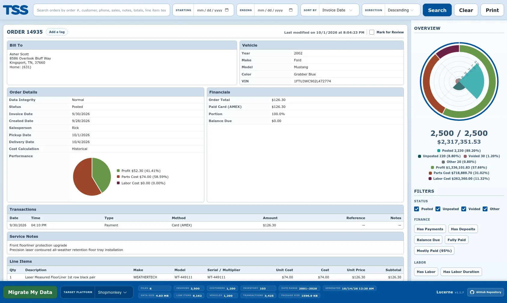
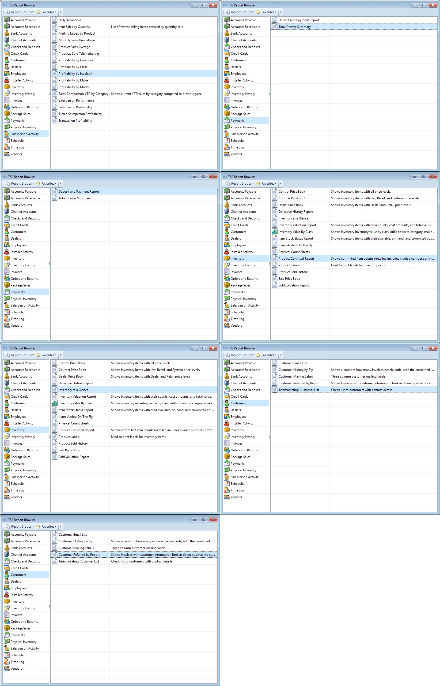
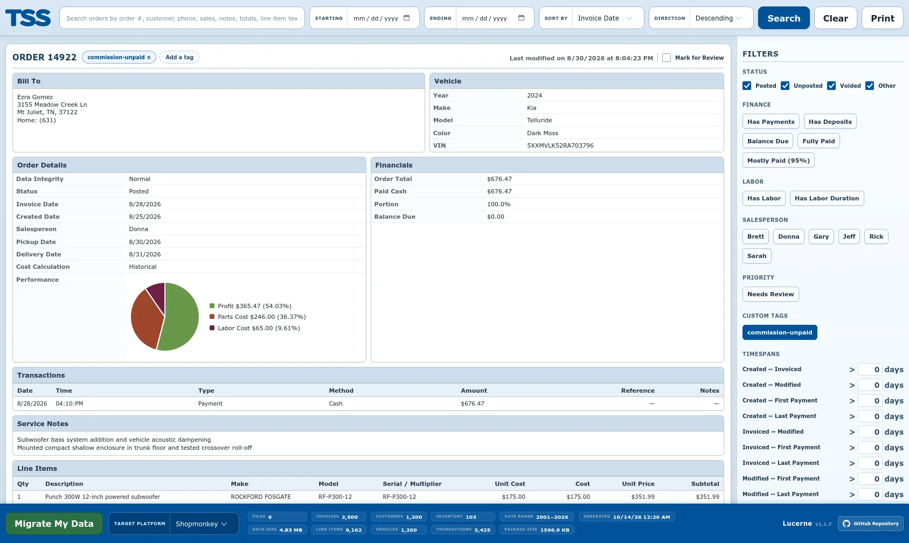
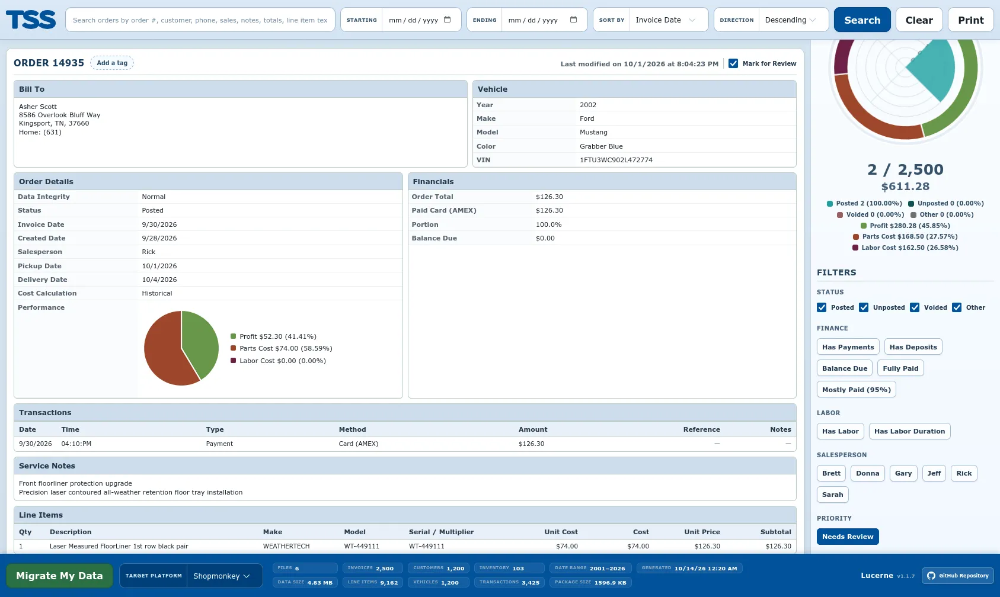
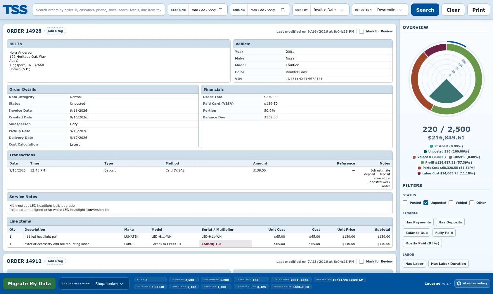
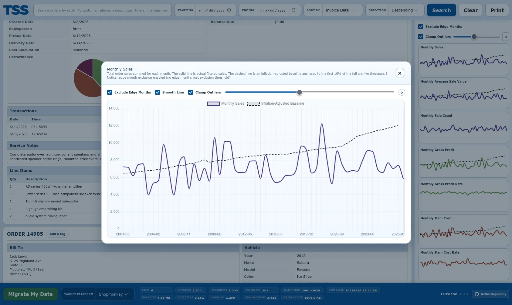

# Liberate, archive, and migrate business data from TSS XP

Lucerne is a data liberator for automotive dealerships, service centers, and upgrade shops using [TSS XP](https://tsshelp.com/), a 2000s-era shop management and point-of-sale (POS) system. Presently licensed and sold by InstallerNet, Inc., TSS does not offer an option to migrate data to another platform, and, although commonly hosted on-prem, its database is resistant to extraction without a NexusDB commercial license. Lucerne bypasses these restrictions by reconstituting fragmented data from reports, which TSS does render in CSV format.

In addition to supporting data migration to modern TSS alternatives, Lucerne sanitizes data by moderately de-duplicating records, clearing obviously malformed ones, standardizing email and phone entries, and replacing carelessly entered vehicles with their probable NHTSA definitions. The original data is preserved in the form of a single HTML file, allowing managers to access the pre-migration state of the business from any web browser. Completely portable, this HTML file features a classic TSS-like interface as well as several useful business insights to help decision makers plan their next chapter.

At the moment, [Shopmonkey](https://www.shopmonkey.io/) is the only officially supported migration target, but the resulting data structure is easily adaptable to other platforms, so others may follow with continued development.



## Getting Started

### 1. Export Reports from TSS XP

Open the **TSS Report Browser** in TSS XP. You must export each of the following seven reports in CSV format. When running each report, always specify that you want the "detailed" version and ensure that the date range encompasses your company's entire operating history so all historical records are captured.



| TSS Report Group | Report Name | Description / Scope | Target CSV Filename |
| :--- | :--- | :--- | :--- |
| **Customers** | `Telemarketing Customer List` | Customer directory with phone numbers and addresses | `customer-telemarketing.csv` |
| **Customers** | `Customer Referred by Report` | Invoices with customer info broken down by referral | `customer-referral.csv` |
| **Inventory** | `Inventory at a Glance` | Inventory catalog and on-hand counts | `inventory-at-a-glance.csv` |
| **Inventory** | `Product Committed Report` | Committed items and associated invoice numbers | `product-committed.csv` |
| **Payments** | `Deposit and Payment Report` | Payment logs and order deposits | `deposit-and-payment.csv` |
| **Payments** | `Total Drawer Summary` | Payment logs and drawer transactions | `total-drawer-summary.csv` |
| **Salesperson Activity** | `Profitability by Invoice#` | Line-item breakdown, parts, labor, and costs per invoice | `transaction-profitability-by-invoice.csv` |

Replacing the demonstration files, put each exported report inside the `input/` folder using the exact same filenames.

### 2. Run the Builder

Ensure you have [Node.js](https://nodejs.org/) installed (v18 or newer recommended). Install project dependencies, then start the pipeline:

```bash
npm install
npm start
```

To run the automated unit test suite (covering financial calculations, data sanitization, and invoice normalization):

```bash
npm test
```

You can also pass optional CLI flags to tailor execution:

```bash
node src/index.js [options]
```

#### Available CLI Options

- `--targets <targets...>`: Specify one or more target platforms to process and bundle (e.g. `--targets shopmonkey`). Targets with empty schema mappings are automatically skipped.
- `--split-every=<number>`: Split generated target spreadsheets into chunks with the specified maximum row count (default: `0`, no splitting).
- `--max-orders=<number>`: Limit the number of orders exported into target spreadsheets.
- `--max-rows=<number>`: Limit the number of rows exported per entity into target spreadsheets.
- `--no-progress`: Disable real-time terminal progress animations.
- `--progress-every=<number>`: Change the terminal progress bar refresh interval in rows (default: `500`).
- `--no-migrate`: Only generate the HTML archive without bundling migration target packages; hides the migration bar.

### 3. Check Outputs

Once the process finishes, open the `output/` directory. There, you will find `archive.html`, an entirely self-contained, standalone file preserving your shop's full operational history.

Double-click `archive.html` or open it with any modern web browser. Because the file bundles its own styles, scripts, and embedded migration packages, it requires no internet connection or web server to explore.

> [!CAUTION]
>
> The archive file contains your company's complete operating records, including financial figures, transaction histories, and personally identifiable customer information (names, phone numbers, home addresses, and more). Store it securely, avoid sending it over unencrypted communication channels, and never host it on a public web server.

## Using the Archive File

### Searching and Filtering Orders

Lucerne renders your historical orders in a searchable, responsive feed.

- **Global Search**: Type order numbers, customer names, phone numbers, vehicle descriptions, salesperson names, invoice notes, or individual line-item part names directly into the top search bar.
- **Date Ranges**: Isolate business activity between specific dates using the **Starting** and **Ending** calendar inputs.
- **Sorting**: Order search results by Invoice Date, Created Date, Order Number, Customer Name, Balance Due, or Order Total in ascending or descending sequence.
- **Side Panel Filters**: Click the **Filters** button in the top navigation bar to slide open detailed filtering criteria, including payment state (Fully Paid, Has Deposits, Balance Due), labor duration, and assigned salesperson.
- **Timespan Intervals**: Filter orders by the number of days elapsed between operational milestones (such as Creation &harr; Invoicing, Invoicing &harr; Final Payment, or First Payment &harr; Final Payment).

### Reviewing and Tagging Orders

Historical records often require manual auditing or follow-up before importing into a new system. Lucerne allows you to organize and curate orders directly within the browser interface.



- **Assigning Custom Tags**: Click **Add a tag** on any order card to attach custom organizational tags (such as warranty claims, commercial fleets, or specific work types). Tags can be created on the fly or selected from previously used tags.
- **Filtering by Tags**: Any tag added to an order instantly populates in the **Custom Tags** section of the sidebar filter list, allowing you to isolate tagged groups with one click.
- **Local Persistence**: All custom tags and notes are automatically saved to your browser's local storage, preserving your review state across sessions without modifying the original data.



- **Mark for Review**: Toggle the **Mark for Review** checkbox in the upper-right corner of any invoice to flag discrepancies, missing documentation, or orders that require team review.
- **Priority Filter**: Use the **Needs Review** button under the Priority section in the sidebar to view all flagged invoices at once.
- **Filtered Print for Auditing**: Click **Print** in the top navigation bar to generate clean, paper-ready invoices or PDF printouts. The print engine dynamically respects your active filters, query strings, and review selections, making it easy to create targeted physical packets or PDF reports for team audits, accountant reviews, or record reconciliation.

### Status and Financial Breakdown

The sidebar provides immediate high-level visibility into your shop's invoice health and status distribution.



- **Status Polar Area Chart**: Visualizes the proportion of **Posted**, **Unposted**, **Voided**, and unclassified orders across the entire database or your active search query.
- **Order Details and Invoiced Financials**: Each order card breaks down parts, labor, shop supplies, tax, deposits, and outstanding balance due alongside customer and vehicle records.
- **Profitability Breakdown**: Fully paid orders feature on-card margin analysis, contrasting adjusted gross profit against parts and labor expenditures.

### Tracking Business Trends

Lucerne calculates key performance indicators across your entire operating history, rendering monthly and daily historical charts.



- **Historical Metrics**: Track Average Order Value (AOV), total gross revenue, order volume, items per sale, labor duration, labor cost rates, inventory cost to sales ratios, and customer acquisition over time.
- **Inflation Adjustment**: Compare historical gross profit and revenue against contemporary purchasing power adjusted by consumer price index (CPI) series data from the Federal Reserve Bank of St. Louis (FRED).
- **Outlier Clamping**: Toggle IQR-based outlier clamping using the sidebar slider to smooth out abnormal transactions or fleet bulk orders without distorting underlying trends.
- **Detailed Trend Inspection**: Click on any trend chart thumbnail to open an expanded modal view with smooth line rendering, edge month exclusions, and high-resolution time series analysis.

## Migrating to a New Platform

At the bottom of the archive interface is the migration bar. This control bar is dedicated entirely to the migration workflow, allowing you to audit your source intake and download the sanitized, platform-ready data bundles directly from your browser.

- **Source File Audit**: The left section of the bar inspects each of the seven TSS reports (`Telemarketing Customer List`, `Customer Referred by Report`, `Inventory at a Glance`, `Product Committed Report`, `Deposit and Payment Report`, `Total Drawer Summary`, and `Profitability by Invoice#`), displaying the exact row count analyzed from your unedited source files (or `0` if an optional source report was omitted).
- **Target Platform Selection**: Choose your destination shop management system from the **Target Platform** selector.
- **Sanitized Package Metrics**: The displayed entity counts (**Customers**, **Vehicles**, **Inventory**, and **Package Size**) do not represent raw unparsed archive rows. Instead, they dynamically update to reflect the post-sanitation numbers generated for the selected migration target package. These figures account for multi-pass customer deduplication, fuzzy phone and email normalization, NHTSA vehicle harmonization, catalog reconciliation, and compressed archive sizing.
- **Direct Package Download**: Clicking **Migrate My Data** instantly unpacks and saves the pre-bundled migration ZIP archive for the chosen platform, complete with step-by-step instructions.
